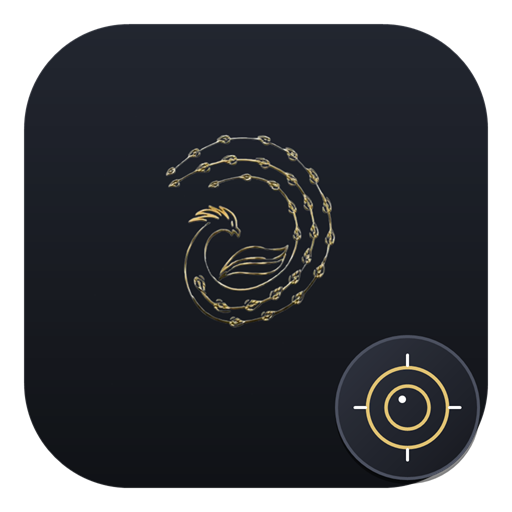
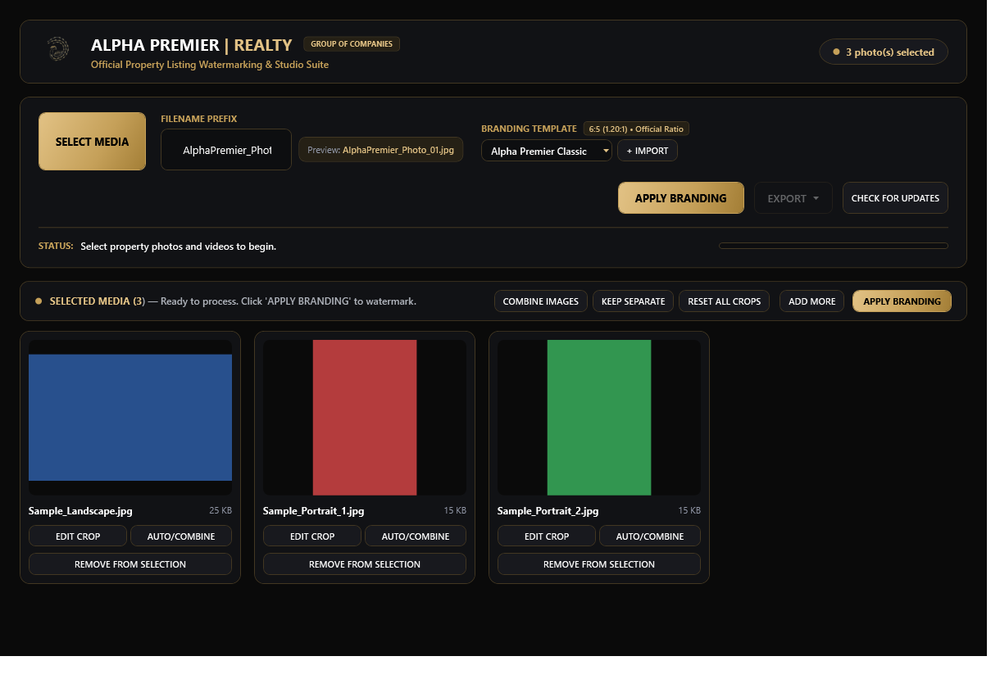
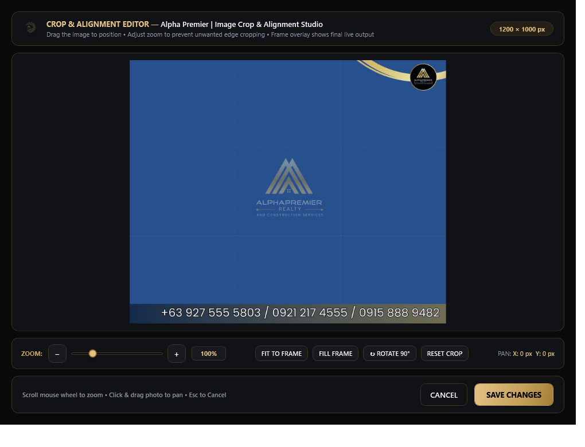
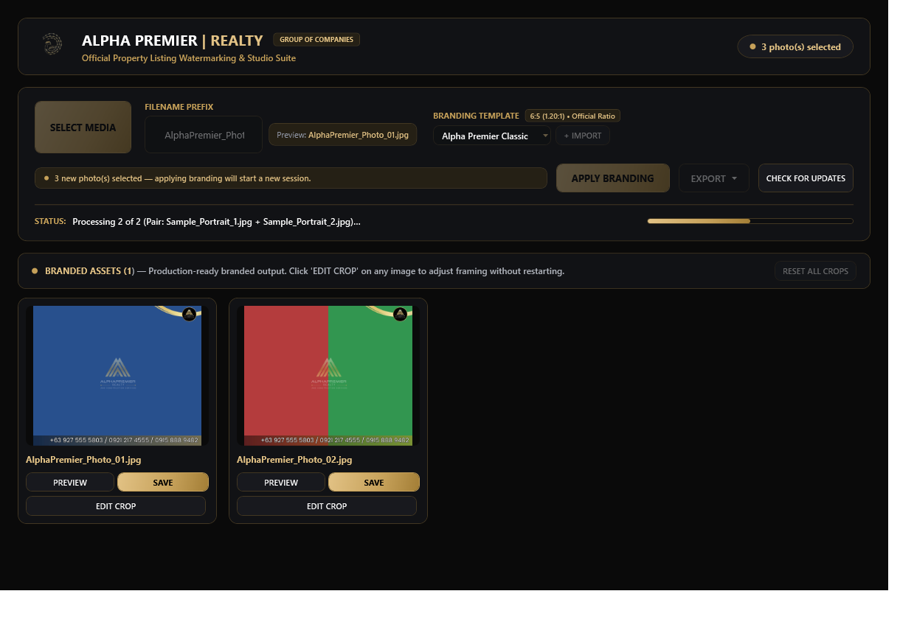
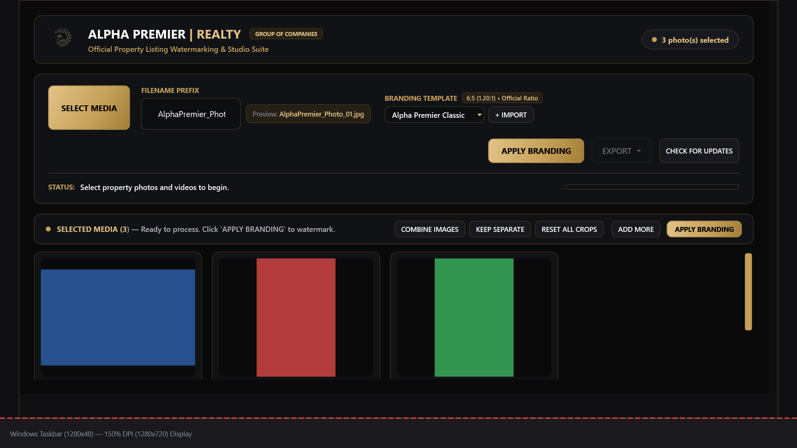
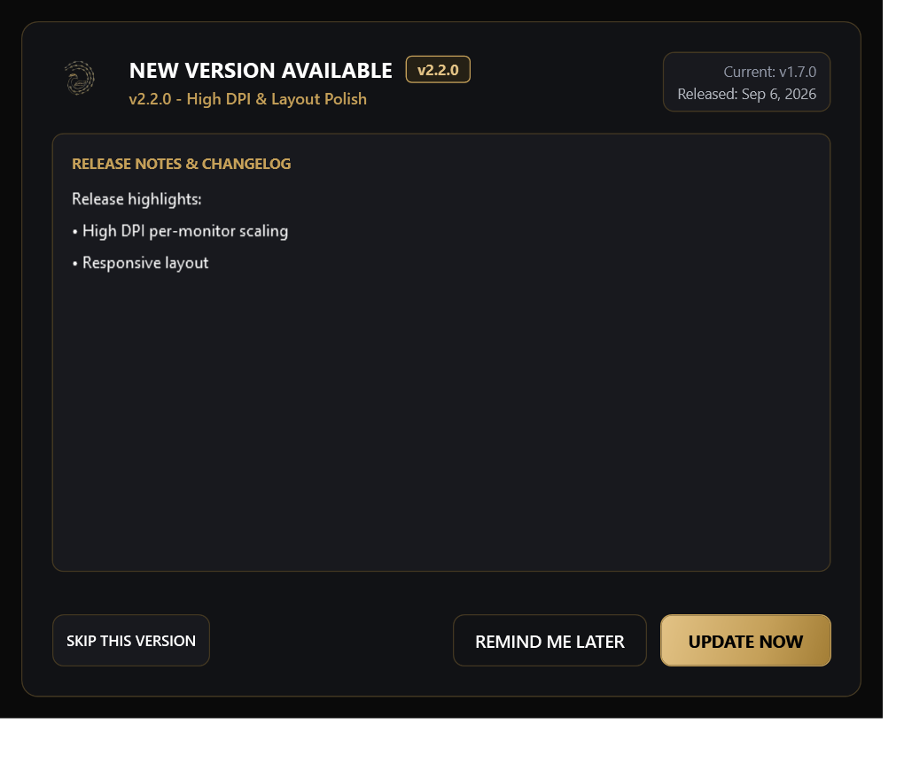

<p align="center">
  
</p>

<h1 align="center">Alpha Premier Realty Branding Studio</h1>

<p align="center">
  <strong>The native Windows desktop studio for luxury real estate branding.</strong><br/>
  Watermark property photos. Interactive crop & align. Batch processing. 100% offline & local.<br/>
  High-DPI responsive C# / .NET 8 WPF application for Windows.
</p>

<p align="center">
  <a href="https://github.com/Deign86/Alpha_Branding/releases">
    
  </a>
  <a href="https://github.com/Deign86/Alpha_Branding/releases/latest">
    
  </a>
  <a href="https://github.com/Deign86/Alpha_Branding/stargazers">
    
  </a>
  <a href="https://github.com/Deign86/Alpha_Branding/blob/main/LICENSE">
    
  </a>
  <a href="https://github.com/Deign86/Alpha_Branding/actions/workflows/release.yml">
    
  </a>
</p>

<p align="center">
  <a href="#what-is-alpha-branding-studio">Overview</a> •
  <a href="#download">Download</a> •
  <a href="#features">Features</a> •
  <a href="#technology-stack">Tech Stack</a> •
  <a href="#silent-rmm-deployment">Enterprise / RMM</a> •
  <a href="#auto-update-system">Auto-Updates</a> •
  <a href="#build-and-test">Build & Test</a> •
  <a href="#repository-layout">Architecture</a>
</p>

<br/>

<p align="center">
  
</p>

<p align="center">
  <em>Dark Gold Luxury theme with staged property media, layout controls, and branding engine</em>
</p>

<br/>

<p align="center">
  
</p>

<p align="center">
  
</p>

<br/>


## What is Alpha Branding Studio?

Alpha Premier Realty Branding Studio is a **high-performance native Windows desktop application** designed specifically for real estate media teams, brokers, and photographers. Originally conceived as a lightweight browser tool, it has been fully refactored and engineered into a robust C# / .NET 8 WPF application with zero browser shell, Electron, or webview overhead.

The application applies the official Alpha Premier Realty luxury gold branding frame to listing photos with sub-millisecond precision, preserving aspect ratios and eliminating distortions while giving operators an interactive, non-destructive cropping and alignment canvas.

- **100% Local & Private** — All image processing, cropping, watermarking, and ZIP archiving take place entirely on-device; no cloud servers, API keys, credentials, or telemetry.
- **Native WPF Architecture** — Built with C#, .NET 8, and XAML utilizing DirectWrite and hardware acceleration; no WebViews or Electron bloat.
- **Interactive Crop & Alignment Studio** — Non-destructive panning, smooth mouse-wheel zooming (10%–400%), 90° clockwise rotation, and instant Fit/Fill presets with a live branding overlay preview.
- **Smart Photo Layout Engine** — Choose between **Combine Pairs** (stitching two vertical shots into a balanced 6:5 frame) and **Separate All** (processing each photo independently).
- **Multi-Format Ingestion** — Supports JPG, JPEG, PNG, BMP, WEBP, and **JFIF** image files.
- **High-DPI Adaptive UI** — Pixel-perfect responsiveness across 100%, 125%, 150%, 175%, and 200% display scaling factors, guaranteeing no clipped buttons on compact laptops or high-resolution displays.
- **Batch Export & Packaging** — Generates sanitized sequential filenames (`AlphaPremier_Photo_01.jpg`) and exports entire batches to a compressed ZIP archive with one click.
- **Authenticode Auto-Updates** — Checks for new GitHub releases silently in the background, verifies digital signatures to prevent tampering, and displays a rich markdown changelog.
- **Enterprise & RMM Deployment** — Includes a dedicated unattended PowerShell script (`Install.ps1`) engineered for Action1 RMM, Microsoft Intune, and CI/CD runners.

---

## Download

| Package | Platform | Format | Description |
| :--- | :--- | :--- | :--- |
| **Windows Installer** | Windows 10 / 11 (x64) | `Alpha.Branding.Setup.exe` | Self-contained single-file bootstrapper. Installs per-user without admin rights. |
| **Portable Archive** | Windows 10 / 11 (x64) | `Alpha.Branding-v*.zip` | Standalone portable executable. Extract and run directly without installation. |
| **Silent RMM Script** | Windows PowerShell | `Install.ps1` | Headless unattended deployment for Action1 RMM, Intune, or automated scripts. |

> **[Download the latest release binaries →](https://github.com/Deign86/Alpha_Branding/releases/latest)**

### Installer Characteristics

- Requires **no separate .NET Desktop Runtime** installation (fully self-contained).
- Installs into `%LOCALAPPDATA%\Alpha Premier Realty\Branding Studio`.
- Requires **no administrator elevation**, MSIX certificates, or UAC prompts.
- Registers a Start Menu shortcut and Windows Apps & Features uninstall entry.
- Clean uninstallation via Apps & Features or by invoking:

```powershell
Alpha.Branding.Setup.exe --uninstall
```

---

## Features

### Interactive Crop & Alignment Studio

Fine-tune every photo before watermarking with the built-in Crop Editor:

| Tool | Shortcut / Action | Functionality |
| :--- | :--- | :--- |
| **Pan / Position** | Click & Drag | Freely adjust photo position behind the branding frame mask |
| **Zoom Slider** | Scroll Wheel / Slider | Zoom seamlessly between 10% and 400% with real-time percentage badge |
| **Fit to Frame** | One-Click Button | Scales image down so entire frame is contained with zero cropping |
| **Fill Frame** | One-Click Button | Scales image up to completely fill the 1200×1000 branding canvas |
| **Rotate 90°** | One-Click Button | Clockwise 90-degree orientation correction |
| **Reset Crop** | One-Click Button | Restores default geometry and alignment instantly |

### Smart Layout Modes

| Layout Mode | Description | Ideal For |
| :--- | :--- | :--- |
| **Combine Pairs** | Automatically stages portrait photographs in side-by-side pairs within a single 6:5 branding frame | Dual room perspectives, detail vignettes, portrait pairs |
| **Separate All** | Treats each photograph as an independent watermarked item | Standard landscape listings, wide exterior shots |

### High-DPI Responsive Engine

The application layout dynamically adapts across standard and high-density monitors:

| Scaling Factor | Equivalent Usable Canvas | Layout Behavior |
| :--- | :--- | :--- |
| **100% DPI (96 DPI)** | 1920×1080 / 1220×840 | Baseline luxury desktop presentation with spacious cards |
| **125% DPI (120 DPI)** | 1536×864 | Responsive compression of padding and badges |
| **150% DPI (144 DPI)** | 1280×720 (672px usable) | Compact header, auto-wrapping button rows, scrollable staging |
| **175% / 200% DPI** | 960×540 / 480px height | Minimum floor enforcement (`840×480`) ensuring zero obscured buttons |

<p align="center">
  
</p>

---

## Silent RMM Deployment (`Install.ps1`)

For automated enterprise rollout via **Action1 RMM**, **Microsoft Intune**, or headless CI/CD runners:

```powershell
# 1. Standard silent local installation (Current User):
powershell.exe -NoProfile -ExecutionPolicy Bypass -File .\Install.ps1

# 2. Remote Action1 RMM deployment with direct GitHub download:
powershell.exe -NoProfile -ExecutionPolicy Bypass -File .\Install.ps1 `
  -DownloadUrl "https://github.com/Deign86/Alpha_Branding/releases/latest/download/Alpha.Branding.Setup.exe" `
  -AllUsers `
  -CreateDesktopShortcut

# 3. Silent uninstallation:
powershell.exe -NoProfile -ExecutionPolicy Bypass -File .\Install.ps1 -Uninstall
```

### Parameter Reference

- `-DownloadUrl <string>`: Automatically fetches the installer binary if not present locally.
- `-AllUsers`: Configures system-wide start shortcuts for all users on the workstation.
- `-CreateDesktopShortcut`: Places an Alpha Premier branding shortcut directly on the desktop.
- `-Uninstall`: Silently removes binaries, shortcuts, and registry entries.

---

## Auto-Update System

Alpha Premier Realty Branding Studio features a native auto-updater connecting to the GitHub Releases API:

<p align="center">
  
</p>

- **Update Triggers:**
  - Non-blocking automatic check 3 seconds after launch.
  - Background periodic check every 8 hours while running.
  - On-demand check via the **"CHECK FOR UPDATES"** header button.
- **Authenticode Signature Verification:**
  - All downloaded update packages are cryptographically validated against official publisher certificates (`Alpha Premier`) prior to execution.
- **User Preferences:**
  - **UPDATE NOW**: Downloads in-place with real-time byte progress, validates signature, and launches bootstrapper.
  - **REMIND ME LATER**: Snoozes notification for 8 hours.
  - **SKIP THIS VERSION**: Ignores specific release tag until a newer version is published.
- **Enterprise Policy Lockdown:**
  - Disable update checks globally via machine environment variable:
    ```powershell
    [Environment]::SetEnvironmentVariable("ALPHA_BRANDING_DISABLE_AUTO_UPDATE", "1", "Machine")
    ```

---

## Technology Stack

- **Language:** C# 12
- **Framework:** .NET 8 (`net8.0-windows10.0.19041.0`)
- **UI Architecture:** Windows Presentation Foundation (WPF), XAML, MVVM
- **Imaging Core:** `SixLabors.ImageSharp` (v3.1.12) for GPU/CPU-optimized pixel transformations and JPEG encoding
- **Packaging:** `System.IO.Compression` for native multi-threaded ZIP export
- **Test Suite:** xUnit covering layout calculations, filename sanitization, image compositing, and DPI scaling

---

## Build and Test

### Prerequisites

- Windows 10 (1809+) or Windows 11
- [.NET 8 SDK](https://dotnet.microsoft.com/download/dotnet/8.0)

### Restore, Build, Test & Format

```powershell
# Restore dependencies
dotnet restore Alpha_Branding.sln -r win-x64

# Compile Release build
dotnet build Alpha_Branding.sln --configuration Release --no-restore

# Execute xUnit test suite
dotnet test Alpha_Branding.sln --configuration Release --no-build

# Verify code formatting
dotnet format Alpha_Branding.sln --verify-no-changes --no-restore
```

### Run Locally

```powershell
dotnet run --project src/Alpha.Branding/Alpha.Branding.csproj
```

### Build Packaged Installer

```powershell
powershell.exe -NoProfile -ExecutionPolicy Bypass `
  -File .\installer\Build-Installer.ps1 `
  -Version 2.2.0.0
```

Output binary: `artifacts/Alpha.Branding.Setup.exe`

---

## Automated Disk Cleanup (`Auto-Clean.ps1`)

Keep repository footprint minimal by automatically pruning build artifacts (`bin/`, `obj/`, `artifacts/`, `TestResults/`):

```powershell
# Standard threshold cleanup (triggers if artifacts exceed 500 MB):
powershell.exe -NoProfile -ExecutionPolicy Bypass -File .\Auto-Clean.ps1

# Custom threshold (e.g. 250 MB):
powershell.exe -NoProfile -ExecutionPolicy Bypass -File .\Auto-Clean.ps1 -ThresholdMB 250

# Dry-run inspection:
powershell.exe -NoProfile -ExecutionPolicy Bypass -File .\Auto-Clean.ps1 -DryRun

# Force immediate purge:
powershell.exe -NoProfile -ExecutionPolicy Bypass -File .\Auto-Clean.ps1 -Force

# Install automatic post-commit Git hook:
powershell.exe -NoProfile -ExecutionPolicy Bypass -File .\Auto-Clean.ps1 -InstallGitHook -ThresholdMB 300
```

---

## Repository Layout

```text
Alpha_Branding.sln
├── src/
│   └── Alpha.Branding/              # Native WPF desktop application
│       ├── Assets/                  # Official logo, branding overlays, icons
│       ├── Models/                  # Processed image, crop settings, release models
│       ├── Services/                # Image processing, template management, update services
│       └── ViewModels/              # MVVM workflow, layout coordination, UI commands
├── installer/
│   ├── Bootstrapper/                # Lightweight native C# bootstrapper
│   └── Build-Installer.ps1          # Single-file packaging script
├── tests/
│   └── Alpha.Branding.Tests/        # xUnit tests & scaling audit screenshot generator
├── docs/
│   └── assets/                      # Application screenshots & visual documentation
├── scaling_audit_issues/            # High-DPI verification snapshots & Nuphus scripts
├── Install.ps1                      # Unattended RMM deployment script
└── Auto-Clean.ps1                   # Automated build artifact cleanup utility
```

---

## License

This project is licensed under the MIT License — see the [LICENSE](LICENSE) file for details.
